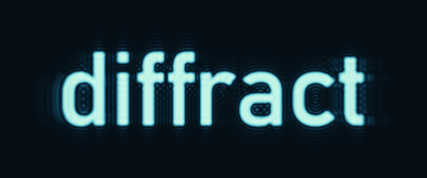
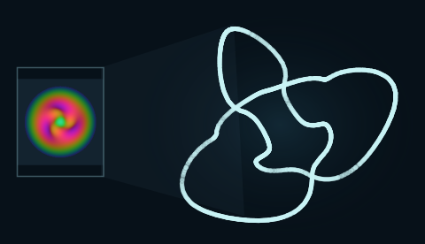
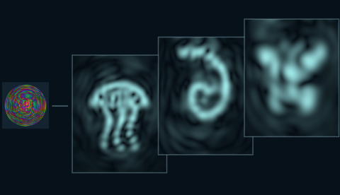
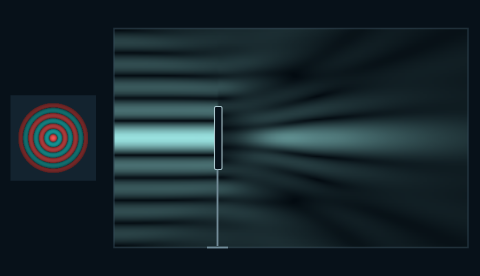

<p align="center">
  
</p>

<p align="center"><strong>Electromagnetic diffraction, in three dimensions.</strong></p>
<p align="center">
  <a href="#explore">Explore</a> &nbsp;·&nbsp;
  <a href="#run-locally">Run locally</a> &nbsp;·&nbsp;
  <a href="#the-physics">The physics</a> &nbsp;·&nbsp;
  <a href="docs/technical-reference.md">Technical reference</a>
</p>

---

**diffract** lets you see the field between the optical element and the screen. Orbit an experiment, move a mirror, compare microscope images, or follow a detector through rings, caustics and knots.

Thirty-six setups explore diffraction, holography, interferometry, microscopy, resonant cavities and evanescent coupling. The three-dimensional field, electric and magnetic vectors, and detector all come from calculated complex fields. A small set of controls keeps the experiment in view; the deeper display settings stay tucked away.

## Explore

<table>
  <tr>
    <td width="33%"></td>
    <td width="33%"></td>
    <td width="33%"></td>
  </tr>
  <tr>
    <td><strong>Knotted phase</strong><br>Follow a trefoil or two linked rings through the zeros of a complex field.</td>
    <td><strong>Holographic metamorphosis</strong><br>One hologram. A jellyfish, a nautilus, and a butterfly at different depths.</td>
    <td><strong>Self-healing light</strong><br>Block the centre of a beam, then find the bright core further downstream.</td>
  </tr>
</table>

There are also three-dimensional bunny and Saturn reconstructions, abruptly autofocusing Airy rings, rotating interference patterns, vortex gratings, fractal and quasiperiodic apertures, and the familiar double slit.

Four complete instruments add **Michelson interferometry**, a **coherent phase-contrast microscope**, a **Fabry–Pérot resonator**, and a **photonic-crystal defect cavity**. Follow the actual split paths, lenses, Fourier-plane phase dot or dielectric layers. The Michelson mirror moves on its translation stage while a fixed detector reveals the interference. The microscope switches between bright field and phase contrast, with shortcuts to specimen, Fourier plane and image. These use ideal optical boundaries, with their approximations stated in the information view.

**Light bending through glass** lets you move a beam’s launch position in graded-index glass and see its curved path change immediately. **Light controlling absorption** combines two opposing coherent beams at a thin resistive film: their relative phase can change absorption from zero to 100%. These tunable fields are recalculated on the GPU from their modal or boundary solutions, with an independent CPU reference.

Three material-boundary experiments go beyond the aperture model: **Evanescent exchange** transfers light between parallel dielectric guides; a **Whispering-gallery cavity** confines a rotating cylindrical mode; and **Light across a forbidden gap** shows frustrated total internal reflection between two glass blocks. These solve their own monochromatic Maxwell boundary problems, including reflected or evanescent fields where applicable. Their finite-height cutaways expose vertically invariant fields; they do not model the scattering of finite-height hardware. The new scenes generate full-resolution fields locally, without downloading precomputed volumes.

- **Manipulate the experiment.** Move the Michelson mirror, shift the graded-index launch, change the absorber’s input phase, or compare microscope contrast. Cavities expose their optical cycle. Diffraction experiments retain the moving detector.
- **Move through the field.** The detector samples on the GPU while you drag. It does not wait for a new propagation calculation.
- **Choose what you see.** Attached preview tabs select electric field, energy, or optical phase; independently switch electric and magnetic vectors on or off. Cavities and the Michelson show mean energy density on their observation plane; forward-propagating setups show axial flux. Electric field defaults to the instantaneous signed component, with RMS available in settings.
- **Look closer.** Inspect a point numerically, compare phase and amplitude, or change the relative phase of two slits.
- **Keep a place.** Each setup has a shareable URL fragment, such as `/#trefoil`, `/#metamorphosis`, or `/#healing`.

Drag to orbit, scroll to zoom, and right-drag to pan. The main control follows the experiment; touching it pauses its automatic motion. **Space** resumes or pauses that motion, **R** reframes the experiment, and **T** cycles through Silver studio, Daylight, Verdigris and Deepwater (**Shift+T** goes back). Preferences reset on reload.

[Browse the experiments and their mathematics →](docs/technical-reference.md#experiments)

## Run locally

You need **Node.js 22+**, **Git LFS**, and a browser with **WebGL 2**. Runtime dependencies are vendored; precomputed field data is stored with Git LFS. No npm install or API key is needed.

After cloning, retrieve the field data before starting:

```sh
git lfs install
git lfs pull
node scripts/serve.mjs
```

Use a Git clone with LFS rather than GitHub's source ZIP, which may contain pointers in place of the field data. For deployments, fetch LFS assets before building so that `dist/` contains the actual simulation data.

Open **[127.0.0.1:5173](http://127.0.0.1:5173/)**.

```sh
# Check the numerical model and shipped data
node --test tests/*.test.mjs

# Build and preview the static application
node scripts/build.mjs
node scripts/serve.mjs --dist
```

The server binds to loopback. Set the `PORT` environment variable to use a different port. The build output in `dist/` can be served as static files.

Each aperture-based setup normally downloads **190–392 KiB** of angular-spectrum data. A worker reconstructs the same complex electric and magnetic fields locally with a GPU inverse FFT, first at preview resolution and then on the full original grid. No retained modes are discarded. Nearby spectra are prefetched, generated volumes use a bounded memory cache, and leaving a setup cancels its work. The approximately 2 GiB collection of reference volumes remains available as a compatibility fallback.

Optical reliefs and the bunny mesh are compressed losslessly, with surface normals calculated in a separate worker. Texture uploads and shader preparation happen before a setup appears. The scene and its controls change together; every setup restores its curated display defaults. The catalogue keeps visible choices in place and gently reveals choices beyond its edges.

### Deploy to Cloudflare

The production build is entirely static. Compact angular spectra use content-addressed URLs and immutable caching. The original compressed fields are also packaged into files of at most 16 MiB for browsers without floating-point worker WebGL; this fallback is byte-for-byte identical to the reference data. There is no server-side Worker code, database, or R2 bucket.

```sh
npm ci
git lfs pull
npm run build
node scripts/check-static.mjs
npx wrangler login
npx wrangler deploy
```

[`wrangler.jsonc`](wrangler.jsonc) attaches the site to **diffract.org**. For later updates, `npm run deploy` rebuilds and deploys. The full-size source volumes remain in Git LFS; generated chunks stay in the ignored `dist/` directory. [Cloudflare's static-asset pricing](https://developers.cloudflare.com/workers/static-assets/billing-and-limitations/) lists free, unlimited asset requests and no storage charge. Domain renewal and any GitHub LFS usage are separate.

## The physics

The aperture-based experiments prescribe a finite, band-limited complex exit field. An angular-spectrum calculation propagates it through vacuum. Every retained plane-wave mode obeys

$$
\mathbf{k}\cdot\widetilde{\mathbf{E}}=0,
\qquad
\widetilde{\mathbf{B}}=\frac{\mathbf{k}\times\widetilde{\mathbf{E}}}{\omega}.
$$

The longitudinal electric field and magnetic components are derived from these relations. Fresnel and far-field behaviour emerge from the same propagation, using the full longitudinal wave number. The detector's energy view shows the time-averaged axial Poynting flux.

**What the picture means matters.** The coloured volume makes an otherwise invisible field observable; its brightness and opacity are display mappings. Hologram outlines and singularity traces are identified guides. The aperture model excludes reflection, material scattering, aperture-edge charges and evanescent fields. The three material-boundary experiments separately solve their ideal cavity or dielectric interfaces, including evanescent coupling and reflection. It is a monochromatic steady state, rather than a simulation of a source switching on.

The test suite covers Maxwell consistency, power conservation, independent diffraction references, numerical convergence, coherent interference, vortex topology, and the actual shipped field volumes.

[Model, assumptions, and equations](docs/technical-reference.md#electromagnetic-model) &nbsp;·&nbsp; [Numerical resolution](docs/technical-reference.md#numerical-resolution-and-performance) &nbsp;·&nbsp; [Validation](docs/technical-reference.md#validation)

## Inside the project

| Part | Responsibility |
| :--- | :--- |
| [`src/experiments.js`](src/experiments.js) | Optical transmissions, dimensions, and catalogue |
| [`src/physics.js`](src/physics.js) | Reference vector angular-spectrum propagation |
| [`src/spectral-volume.js`](src/spectral-volume.js) | Compact-spectrum GPU reconstruction in a worker |
| [`src/scene3d.js`](src/scene3d.js) · [`src/render-shaders.js`](src/render-shaders.js) | Three-dimensional rendering and detector sampling |
| [`src/display-presets.js`](src/display-presets.js) | Curated display defaults |
| [`scripts/`](scripts/) | Reproducible field, geometry, and preview generation |
| [`tests/`](tests/) | Numerical and stored-data checks |

To change an experiment, update its boundary definition and regenerate the affected assets. The [development commands](docs/technical-reference.md#numerical-resolution-and-performance) and [source map](docs/technical-reference.md#source-layout) describe that workflow. Rendering changes should be checked both numerically and in the browser, including detector motion and narrow viewports.

<details>
<summary><strong>About the animated wordmark</strong></summary>

The opening animation is a small optical experiment of its own. A complex-amplitude hologram is formed by back-propagating the word **diffract**, applying a finite pupil, and propagating forward again with the application's vector angular spectrum. A detector travels away from the image plane and returns. The frames show calculated axial energy flux at fixed exposure; no text layer is pasted over the result.

[`scripts/bake-readme.mjs`](scripts/bake-readme.mjs) regenerates the animation and icon exports. It needs ImageMagick and FFmpeg, only for preparing the documentation assets. The committed raster target makes regeneration independent of installed fonts. [Generation parameters and numerical checks](docs/media/generation.json) accompany the artwork. A [still image](docs/media/diffract-poster.png) is also available.

</details>

## Acknowledgements

Built with [Three.js](https://threejs.org/) and [KaTeX](https://katex.org/). The bunny geometry comes from the [Stanford 3D Scanning Repository](https://graphics.stanford.edu/data/3Dscanrep/), via Open3D. Bundled dependencies retain their licences in [`vendor/`](vendor/); model attribution and redistribution terms are in [`assets/models/NOTICE.txt`](assets/models/NOTICE.txt). Research references are collected beside the corresponding [experiments](docs/technical-reference.md#experiments).
